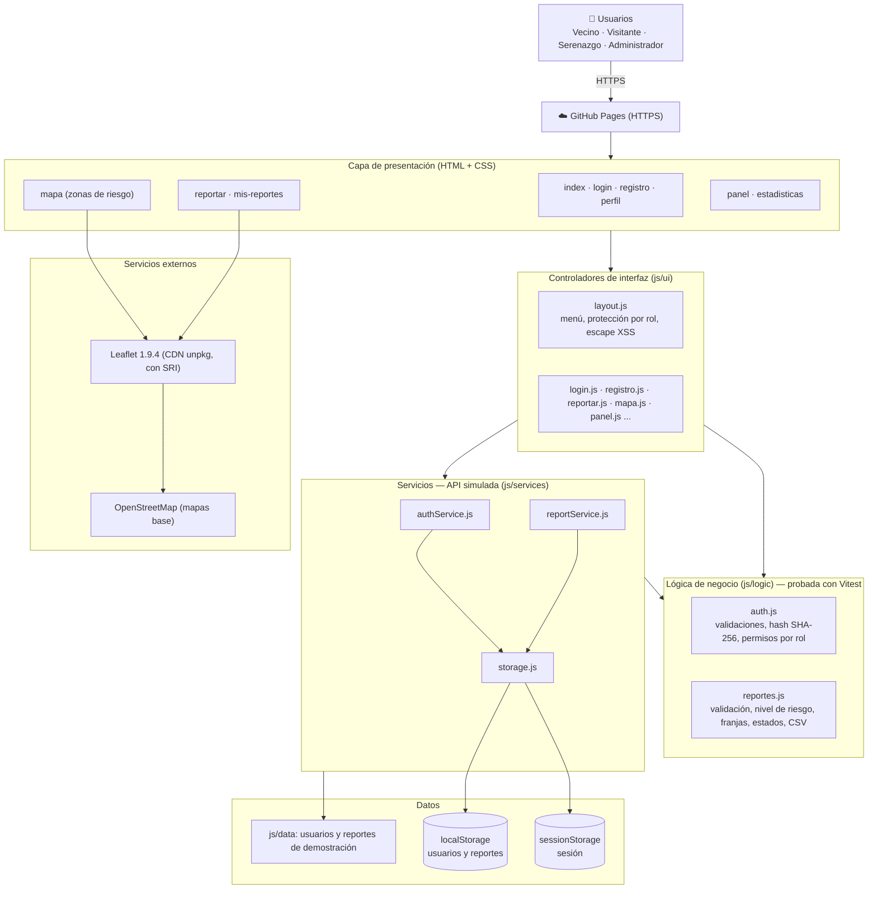

# P3 — Arquitectura lógica

SJL Alerta es una **aplicación web estática (solo frontend)**. El backend y la base de datos se **simulan** en el navegador con una capa de servicios en JavaScript y `localStorage`. Esta arquitectura permite desplegar gratis en GitHub Pages y dejar preparada la sustitución por una API real en una siguiente versión.

## Diagrama

## Componentes y comunicación

| Capa | Componentes | Responsabilidad | Se comunica con |
|---|---|---|---|
| **Frontend** | 9 páginas HTML + `styles.css` | Interfaz de cada rol | Controladores (`js/ui`) mediante módulos ES |
| **Controladores** | `js/ui/*.js` | Leer formularios, pintar tablas y mapa, redirigir | Lógica y servicios (llamadas a funciones) |
| **Lógica de negocio** | `auth.js`, `reportes.js` | Reglas del caso: validaciones, nivel de riesgo (≥10 Alto, 5–9 Medio, <5 Bajo), franjas horarias, estados | Nadie (funciones puras, por eso se prueban en el pipeline) |
| **Backend / API (simulada)** | `authService.js`, `reportService.js` | Simula los endpoints: login, registro, crear y listar reportes, cambiar estado | `storage.js` |
| **Base de datos (simulada)** | `localStorage`, `sessionStorage`, `js/data` | Persistir usuarios y reportes; guardar la sesión | — |
| **Autenticación** | `auth.js` + `authService.js` + `layout.js` | Hash SHA-256 de contraseñas, sesión por pestaña, control de acceso por rol | Servicios y controladores |
| **Servicios externos** | Leaflet + OpenStreetMap | Mapa interactivo y teselas | Páginas `mapa` y `reportar` |
| **Infraestructura** | GitHub Pages | Hosting estático con HTTPS | Usuarios |

## Roles y acceso

| Página | Vecino | Serenazgo | Administrador | Sin sesión |
|---|---|---|---|---|
| Inicio, Mapa de riesgo | ✅ | ✅ | ✅ | ✅ |
| Reportar, Mis reportes | ✅ | ❌ | ❌ | ❌ |
| Panel de atención | ❌ | ✅ | ✅ | ❌ |
| Estadísticas | ❌ | ❌ | ✅ | ❌ |
| Mi perfil | ✅ | ✅ | ✅ | ❌ |

## Evolución prevista (siguiente versión)
Reemplazar `js/services` por llamadas `fetch` a una API REST (por ejemplo Node.js + PostgreSQL con autenticación JWT). Como la interfaz solo conoce los servicios, las páginas y la lógica no cambian.
