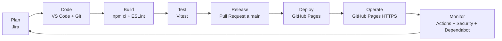

# P3 — Stack tecnológico en el ciclo DevSecOps

## Herramientas y seguridad por fase

| Fase | Herramienta | Qué hace en el proyecto | Control de seguridad (shift-left) |
|---|---|---|---|
| **Plan** | Jira (Scrum) | Épicas, historias con criterios de aceptación, story points, MoSCoW, sprints y tablero Kanban | Requisitos de seguridad dentro de las historias: contraseñas de 8+ caracteres (HU02), acceso por rol (HU04), reporte anónimo contra represalias (HU08) |
| **Code** | Visual Studio Code, Git, GitHub | Desarrollo en la rama `test`, commits con *Conventional Commits* | Rama `main` protegida por Pull Request; contraseñas guardadas como hash SHA-256; escape de HTML contra XSS; reglas ESLint que prohíben `eval` |
| **Build** | Node.js 22, `npm ci`, ESLint | Instala versiones exactas (`package-lock.json`) y revisa la calidad del código | Instalación reproducible (evita dependencias alteradas); análisis estático de calidad |
| **Test** | Vitest | 41 pruebas unitarias de la lógica (login, permisos, validaciones, nivel de riesgo, estados, CSV) | Pruebas de seguridad funcional: un vecino no puede entrar al panel, el CSV no expone autores anónimos, el hash no se devuelve |
| **Release** | GitHub Pull Requests + GitHub Actions | Cada sprint se integra a `main` con un PR que debe pasar el pipeline | Gate de seguridad: no se integra si falla build, test o security |
| **Deploy** | GitHub Actions → GitHub Pages | Despliegue automático solo desde `main`, publicando únicamente HTML/CSS/JS | Permisos mínimos del token (`contents: read`; `pages: write` solo en deploy); no se publican tests ni configuración |
| **Operate** | GitHub Pages | Hosting estático con HTTPS | HTTPS obligatorio; Leaflet cargado con **SRI** (`integrity`) para impedir scripts alterados en el CDN; sin backend expuesto |
| **Monitor** | GitHub Actions, pestaña Security, Dependabot | Historial de ejecuciones, alertas de CodeQL y de dependencias | Dependabot revisa vulnerabilidades cada semana y propone actualizaciones |

## Seguridad en el pipeline (etapa 3)

| Control | Herramienta | Qué detecta |
|---|---|---|
| **SAST** | CodeQL | Vulnerabilidades en el código JavaScript (XSS, inyecciones, malas prácticas) |
| **Análisis de dependencias (SCA)** | `npm audit` + Dependabot | Librerías con vulnerabilidades conocidas (falla con severidad alta o crítica) |
| **Escaneo de secretos** | Gitleaks | Claves, tokens o contraseñas subidas por error al repositorio |

Excepción documentada en `.gitleaks.toml`: `js/data/usuarios.js` contiene hashes de cuentas de demostración, no secretos reales.

## Justificación del stack según el caso

| Decisión | Por qué encaja con el problema de SJL |
|---|---|
| **Web estática (HTML, CSS, JS)** | Los vecinos acceden desde cualquier celular sin instalar nada; carga rápida con datos móviles; cero costo de servidor para un MVP municipal |
| **Leaflet + OpenStreetMap** | Mapa gratuito y sin API key; muestra la concentración de incidentes por zona y horario, que es el núcleo del caso |
| **localStorage como base simulada** | Permite validar el flujo completo (reporte → mapa → serenazgo) antes de invertir en backend |
| **Jira Scrum** | Entregas semanales priorizando lo que más reduce el riesgo (Must primero) |
| **GitHub Actions** | Integrado con el repositorio, gratis para repos públicos, permite automatizar build, pruebas, seguridad y despliegue |
| **CodeQL, Gitleaks, npm audit** | El sistema maneja reportes sensibles (extorsión, drogas): la seguridad se revisa en cada cambio, no al final |
| **GitHub Pages** | Despliegue gratuito con HTTPS y URL pública, ideal para el MVP |
