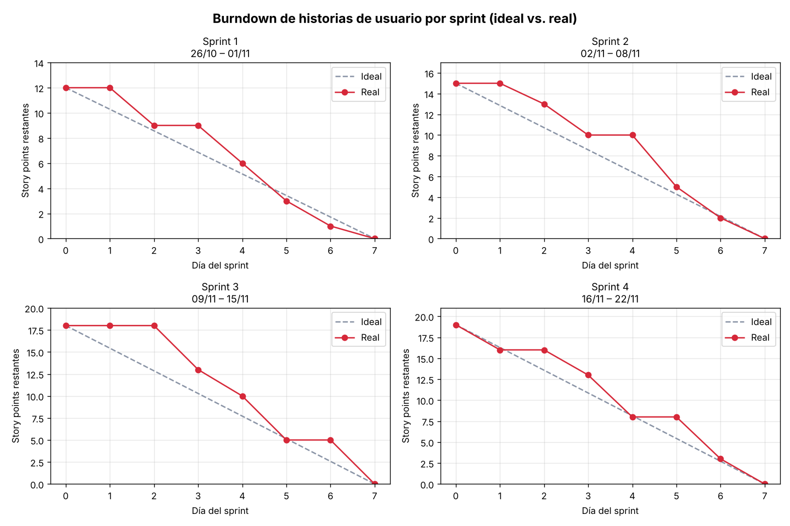
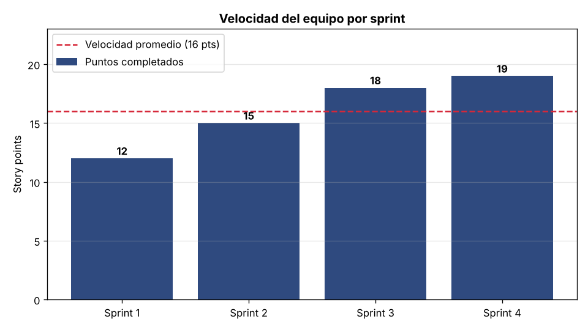
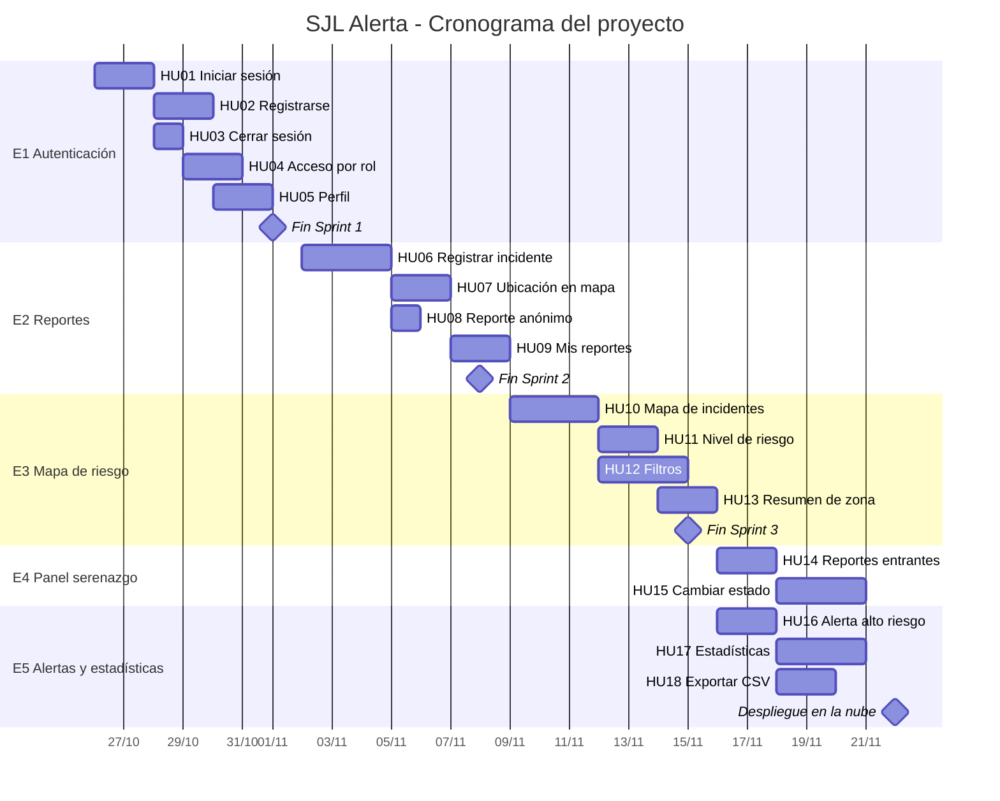

# P2 — Simulación de 4 sprints

- **Duración de cada sprint:** 1 semana (7 días). Proyecto de 4 semanas: 26/10/2026 – 22/11/2026.
- **Estimación:** planning poker con escala Fibonacci (1, 2, 3, 5, 8). Historia de referencia: HU03 (1 punto).
- **Priorización:** MoSCoW (Must, Should, Could, Won't).
- **Nota:** los sprints se simularon con fechas retroactivas; la implementación del código se realizó durante la práctica.

## Planificación de sprints

| Sprint | Fechas | Sprint goal | Sprint backlog | Puntos |
|---|---|---|---|---|
| **Sprint 1** | 26/10 – 01/11 | Usuarios pueden registrarse e iniciar sesión con acceso según su rol | HU01 (3), HU02 (3), HU03 (1), HU04 (3), HU05 (2) | **12** |
| **Sprint 2** | 02/11 – 08/11 | Vecinos pueden reportar incidentes y consultar el estado de sus reportes | HU06 (5), HU07 (5), HU08 (2), HU09 (3) | **15** |
| **Sprint 3** | 09/11 – 15/11 | Vecinos y visitantes pueden identificar zonas y horarios de riesgo en un mapa de SJL | HU10 (5), HU11 (5), HU12 (5), HU13 (3) | **18** |
| **Sprint 4** | 16/11 – 22/11 | Serenazgo atiende reportes desde su panel y el administrador ve estadísticas; solución desplegada en la nube | HU14 (3), HU15 (5), HU16 (3), HU17 (5), HU18 (3) | **19** |
| Backlog | — | Fuera del alcance (Won't) | HU19 (8) | 8 |

## Burndown de historias por sprint (ideal vs. real)

| Día | 0 | 1 | 2 | 3 | 4 | 5 | 6 | 7 |
|---|---|---|---|---|---|---|---|---|
| Sprint 1 (real) | 12 | 12 | 9 | 9 | 6 | 3 | 1 | 0 |
| Sprint 2 (real) | 15 | 15 | 13 | 10 | 10 | 5 | 2 | 0 |
| Sprint 3 (real) | 18 | 18 | 18 | 13 | 10 | 5 | 5 | 0 |
| Sprint 4 (real) | 19 | 16 | 16 | 13 | 8 | 8 | 3 | 0 |

**Lectura:** en el Sprint 3 la línea real quedó por encima de la ideal durante los primeros días, porque la integración del mapa (Leaflet) y el cálculo de zonas tomó más de lo previsto; se recuperó al final del sprint. En todos los sprints se completó el 100 % de lo comprometido.

## Velocidad

| Sprint | Comprometido | Completado |
|---|---|---|
| Sprint 1 | 12 | 12 |
| Sprint 2 | 15 | 15 |
| Sprint 3 | 18 | 18 |
| Sprint 4 | 19 | 19 |
| **Promedio** | | **16 puntos por sprint** |

La velocidad creció de 12 a 19 puntos a medida que la base del proyecto (estructura, servicios y pipeline) quedó estable. Con 16 puntos por sprint, la HU19 (8 puntos) entraría en un quinto sprint junto con otras mejoras.

## Diagrama de Gantt

**Dependencias principales:** HU02, HU03 y HU05 dependen de HU01 (sesión); HU07 y HU09 dependen de HU06 (reporte creado); HU11, HU12 y HU13 dependen de HU10 (mapa base); HU15 y HU18 dependen de HU14 (panel). **Hitos:** el cierre de cada sprint y el despliegue final.

## Tablero Kanban

Columnas en Jira: **To Do → In Progress → In Review → Done**.

| Columna | Límite WIP | Regla |
|---|---|---|
| To Do | — | Historias del sprint aún no iniciadas |
| In Progress | **3** | Historia en desarrollo |
| In Review | **2** | Código subido a `test`, esperando pipeline y Pull Request |
| Done | — | Pipeline en verde y PR fusionado en `main` |

La evidencia del flujo de cada sprint está en las capturas del informe y en el tablero de Jira.
